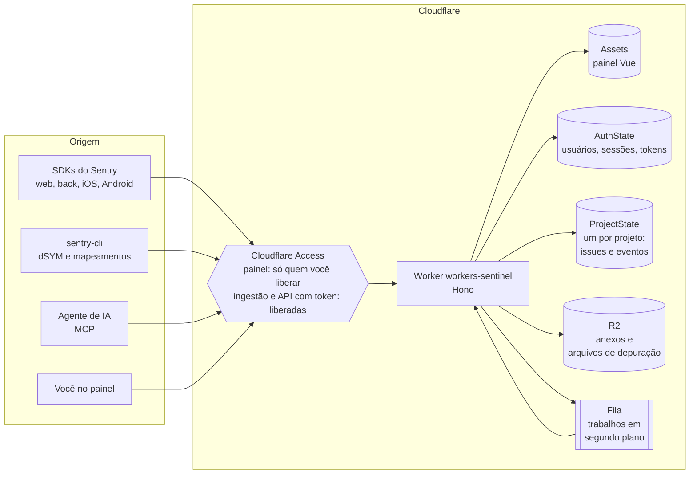

# Sentinel na Cloudflare

Rastreador de erros compatível com o Sentry (os SDKs do Sentry funcionam trocando só o DSN), rodando
inteiro na sua conta da Cloudflare: um Worker, Durable Objects com SQLite, R2 e uma fila. Sem servidor
para cuidar.

Esta pasta é o modelo do botão. Ela instala o Sentinel do fork
[didisouzacosta/sentinel-lab](https://github.com/didisouzacosta/sentinel-lab): painel novo, MCP,
integrações com Slack e Kaneo, anexos e arquivos de depuração (dSYM e ProGuard/R8).

[](https://deploy.workers.cloudflare.com/?url=https://github.com/didisouzacosta/sentinel-lab/tree/main/template)

## Sumário

- [Arquitetura](#arquitetura)
- [Como funciona](#como-funciona)
- [Antes de começar](#antes-de-começar)
- [Instalar com o botão](#instalar-com-o-botão)
- [Instalar na mão](#instalar-na-mão)
- [Depois do deploy (obrigatório)](#depois-do-deploy-obrigatório)
- [Segurança](#segurança)
- [Ligar um app ou site](#ligar-um-app-ou-site)
- [Prompts para a IA](#prompts-para-a-ia)
- [Simbolicação (opcional)](#simbolicação-opcional)
- [Atualizar](#atualizar)

## Arquitetura



| Peça | Papel |
|---|---|
| Worker `workers-sentinel` | Recebe os eventos (`/api/{projeto}/envelope`), serve a API do painel, a API `/api/0` no formato do Sentry e o MCP (`/mcp`) |
| Assets | O painel (Vue), servido direto da borda |
| Durable Object `AuthState` | Um só: usuários, sessões, chaves de acesso (passkeys), tokens de API e o registro de auditoria |
| Durable Object `ProjectState` | Um por projeto: issues, eventos, filtros, integrações e limites, em SQLite |
| R2 `ATTACHMENTS` | Anexos enviados junto com os eventos |
| R2 `DEBUG_FILES` | dSYM, mapeamentos ProGuard/R8 e pedaços de upload do `sentry-cli` |
| Fila `PROCESS_QUEUE` | Monta os uploads grandes do `sentry-cli` fora do pedido |

## Como funciona

1. **Ingestão.** O SDK manda o evento para o DSN do projeto
   (`https://{chave}@{seu-host}/{projeto}`). O Worker confere a chave, limpa o que é sensível (cabeçalhos
   de autorização, cookies, parâmetros com cara de segredo) e entrega ao `ProjectState` do projeto.
2. **Agrupamento.** O `ProjectState` calcula a impressão digital do erro, junta na issue certa e guarda o
   evento em SQLite. Os anexos vão para o R2.
3. **Painel.** Você entra com senha e depois com passkey, e vê issues, eventos, releases e avisos. A
   administração só abre em sessão aberta com passkey.
4. **Avisos.** Cada projeto pode mandar para o Slack, criar tarefa no Kaneo ou chamar um webhook. As
   credenciais ficam cifradas com o `INTEGRATIONS_KEY`.
5. **Agentes.** Com um token de API, um agente (Claude Code, por exemplo) usa o MCP para criar projetos,
   pegar o DSN, mandar um evento de teste e tratar as issues.

## Antes de começar

- Conta na Cloudflare. O plano grátis do Workers serve para começar (Durable Objects com SQLite, R2 e
  filas estão nele). O pago (US$ 5/mês) dá mais volume e é obrigatório para a simbolicação.
- O R2 habilitado na conta (painel da Cloudflare → R2; pede a confirmação uma vez, mesmo no plano grátis).
- Um domínio na Cloudflare para pôr o Access na frente. Dá para começar no `workers.dev`.

## Instalar com o botão

1. Clique em **Deploy to Cloudflare** acima.
2. A Cloudflare cria uma cópia desta pasta no seu GitHub e mostra a configuração:
   - **SETUP_TOKEN:** gere com `openssl rand -hex 24` e **guarde**. Ele é pedido no primeiro cadastro,
     que vira o admin. No endereço `workers.dev`, sem ele ninguém consegue se cadastrar.
   - **INTEGRATIONS_KEY:** gere com `openssl rand -hex 32`. Cifra as credenciais do Slack e do Kaneo.
   - Os buckets R2 e a fila já vêm com nome; pode deixar.
3. A Cloudflare instala, publica e mostra o endereço (`https://workers-sentinel.<sua-conta>.workers.dev`).
4. Siga [Depois do deploy](#depois-do-deploy-obrigatório).

Cada push na branch principal da sua cópia publica de novo. O código do Sentinel vem do pacote do release
[`template`](https://github.com/didisouzacosta/sentinel-lab/releases/tag/template) do fork, gerado a cada
versão que passou nos testes e entrou em produção.

## Instalar na mão

```bash
npx degit didisouzacosta/sentinel-lab/template meu-sentinel
cd meu-sentinel
npm install
npx wrangler login
npx wrangler secret put SETUP_TOKEN        # cole: openssl rand -hex 24 (guarde)
npx wrangler secret put INTEGRATIONS_KEY   # cole: openssl rand -hex 32
npx wrangler deploy                        # cria os buckets e a fila, se faltarem
```

Para rodar no seu computador: `cp .dev.vars.example .dev.vars`, troque os valores e rode `npx wrangler dev`.

## Depois do deploy (obrigatório)

1. **Crie o admin** com o `SETUP_TOKEN` (a tela de cadastro ainda não tem campo para ele):
   ```bash
   curl -X POST https://SEU-HOST/api/auth/register \
     -H 'content-type: application/json' \
     -d '{"email":"voce@empresa.com","name":"Seu nome","password":"uma-senha-forte","setupToken":"SEU_SETUP_TOKEN"}'
   ```
2. **Entre no painel** com esse e-mail e senha, cadastre uma **passkey** em *Settings* e entre de novo
   com ela: a administração só abre em sessão de passkey.
3. **Feche o cadastro** se só a sua equipe vai usar: *Administration → Settings → Open registration*
   desligado. Os outros entram pelo admin (*Administration → Users*).
4. **Ponha um domínio**: Workers → `workers-sentinel` → Settings → Domains & Routes → Custom domain
   (ex.: `sentinel.suaempresa.com.br`).
5. **Ponha o Cloudflare Access na frente** do domínio (Zero Trust → Access → Applications, self-hosted),
   com política *Allow* para os e-mails da equipe e estes caminhos **públicos** (SDKs e ferramentas não
   fazem login no Access; cada um tem a própria autenticação):
   `/api/*/envelope`, `/api/*/envelope/`, `/api/*/store`, `/api/*/store/`, `/api/health`, `/api/0/*`,
   `/mcp` e `/api/hooks/*`.
6. **Desligue o `workers.dev`** (senão o painel continua aberto por lá, sem Access): Settings → Domains &
   Routes → workers.dev → Disable, e `"workers_dev": false` no `wrangler.jsonc` da sua cópia.

## Segurança

O que já vem no código:

| Camada | O que faz |
|---|---|
| Primeiro cadastro | Exige o `SETUP_TOKEN`; no `workers.dev` sem token, o cadastro é recusado |
| Senhas | argon2id; 5 erros por e-mail bloqueiam 15 min; 5 cadastros por hora por IP |
| Passkeys | WebAuthn; a administração só abre em sessão de passkey |
| Tokens e sessões | Guardados como hash; trocar a senha derruba todas as sessões |
| Ingestão | Limites de tamanho (inclusive gzip), dados sensíveis limpos antes de guardar, cota de eventos por hora por projeto |
| Integrações | Credenciais cifradas com o `INTEGRATIONS_KEY`; webhooks só HTTPS e nunca para endereços internos |
| Painel | CSP estrita e cabeçalhos de segurança |

O que ligar na Cloudflare (cabe no plano grátis):

1. **Cloudflare Access** como em [Depois do deploy](#depois-do-deploy-obrigatório).
2. **Regra de rate limiting** da zona na ingestão (Security → WAF → Rate limiting rules): caminhos que
   terminam em `/envelope` ou `/store` no seu host, 300 pedidos em 10 s por IP, bloqueio de 10 s. O plano
   grátis tem uma regra só: se ela já existe para outro serviço, junte as condições com `or`.
3. **TLS mínimo 1.2** e **HSTS** no host (SSL/TLS → Edge Certificates; Rules → Transform Rules).
4. **Alerta de ataque DDoS** (Notifications → HTTP DDoS Attack Alert).

O que **não** ligar: **Bot Fight Mode** e **"Under Attack"** no domínio inteiro. Eles bloqueiam os SDKs
dos apps e dos servidores, que não rodam o desafio em JavaScript.

## Ligar um app ou site

Crie o projeto no painel (ou pelo MCP) e use o DSN em qualquer SDK do Sentry:

```js
import * as Sentry from '@sentry/browser';

Sentry.init({ dsn: 'https://CHAVE@sentinel.suaempresa.com.br/PROJETO' });
```

- **iOS:** o SDK [`sentinel-ios`](https://github.com/didisouzacosta/sentinel-ios) (Swift, SPM) ou o
  `sentry-cocoa`. Para ver os crashes com nome de função, mande os dSYMs com o `sentry-cli`.
- **Android:** o `sentry-android` com o DSN; mande o `mapping.txt` do R8 com o `sentry-cli`.
- **Back (Node, Deno, Workers, Python, Go…):** o SDK do Sentry da linguagem, com o DSN.
- A tela *Setup* do painel tem o passo a passo de cada plataforma e o comando do MCP.

## Prompts para a IA

Para colar num assistente com acesso ao terminal e ao código (Claude Code, Cursor…). Troque o que está
entre `<>`.

### 1. Instalar do zero até a Cloudflare

```text
Quero instalar o Sentinel (rastreador de erros compatível com o Sentry) na minha conta da Cloudflare,
usando o modelo https://github.com/didisouzacosta/sentinel-lab/tree/main/template. Leia o README.md dele
antes e siga "Instalar na mão" e "Depois do deploy", me mostrando cada comando antes de rodar.

Dados:
- Domínio: <sentinel.suaempresa.com.br> (a zona já está na minha conta)
- E-mails da equipe que podem entrar no painel: <voce@suaempresa.com.br>

Regras:
1. Confira `npx wrangler whoami` e se o R2 está habilitado na conta.
2. Gere o SETUP_TOKEN e o INTEGRATIONS_KEY com openssl e grave como segredos do Worker
   (wrangler secret put); nunca em arquivo versionado. Me mostre o SETUP_TOKEN uma vez para eu guardar.
3. Publique, crie o admin com o curl do README e me diga como cadastrar a passkey.
4. Ponha o domínio, crie a aplicação do Cloudflare Access com os caminhos públicos do README e a regra
   de rate limiting na ingestão, e desligue o workers.dev.
5. Confira: /api/health responde 200 sem login, o painel pede o login do Access e um envelope com chave
   inventada dá 401.
6. Me entregue um resumo do que foi criado (Worker, buckets, fila, Access, regra) e onde está cada coisa.
```

### 2. Ligar um site ou back-end

```text
Quero mandar os erros deste projeto para o meu Sentinel, em https://<sentinel.suaempresa.com.br>.
O Sentinel fala o protocolo do Sentry: use o SDK oficial do Sentry da linguagem com o DSN
<https://CHAVE@sentinel.suaempresa.com.br/PROJETO> (painel → Setup).

Faça:
1. Descubra a linguagem e o framework e instale o SDK do Sentry certo, com o DSN vindo de variável de
   ambiente (nunca fixo no código) e desligado em desenvolvimento e nos testes.
2. Se o projeto já tem uma camada de erros (interface, adapter), ponha o Sentinel atrás dela.
3. Ligue release (versão do app) e environment (produção, staging). Desligue o envio de dados pessoais
   (sendDefaultPii: false) e não mande nome, e-mail, telefone nem corpo de requisição.
4. Se o site tem Content-Security-Policy, libere o host do Sentinel em connect-src.
5. Teste com um erro de propósito e me diga onde ver a issue no painel.
```

### 3. Ligar um app (iOS ou Android)

```text
Quero mandar os crashes deste app para o meu Sentinel, em https://<sentinel.suaempresa.com.br>, com o
DSN <https://CHAVE@sentinel.suaempresa.com.br/PROJETO>. Leia o README de
https://github.com/didisouzacosta/sentinel-lab/tree/main/template ("Ligar um app ou site").

Faça:
1. iOS: use o SDK sentinel-ios (SPM, https://github.com/didisouzacosta/sentinel-ios) ou o sentry-cocoa.
   Android: o sentry-android. DSN por configuração de build, desligado em debug.
2. Ligue release (versão + build) e environment.
3. Configure o envio dos símbolos no build de release: dSYMs (iOS) ou mapping.txt do R8 (Android) com
   o sentry-cli apontando para o Sentinel (URL do Sentinel e um token de API com acesso Projects),
   sem o token no repositório.
4. Não mande dado pessoal. Me diga o que declarar nas lojas (App Store: "Dados de diagnóstico";
   Google Play: segurança dos dados).
5. Teste num simulador com um crash de propósito e me diga onde conferir.
```

### 4. Conectar o MCP

```text
Conecte o MCP do meu Sentinel a este agente: endereço https://<sentinel.suaempresa.com.br>/mcp, com um
token de API que eu vou colar no terminal (painel → Settings → API tokens, acesso "Read & write").
Use `claude mcp add --transport http sentinel <url>/mcp --header "Authorization: Bearer <token>"`,
sem gravar o token em arquivo versionado, e teste listando os projetos.
```

## Simbolicação (opcional)

Para ver crashes nativos com nome de função, arquivo e linha (iOS) e com as classes reais (Android), o
Sentinel roda o [Symbolicator](https://github.com/getsentry/symbolicator) num contêiner da Cloudflare. O
botão não cria contêiner, então este modelo vem com `SYMBOLICATION=off`: os arquivos de depuração são
guardados e o painel avisa quais faltam, mas os eventos ficam como chegaram.

Para ligar (Workers Paid e Docker na máquina que publica): siga a seção "Symbolication" do
[README do fork](https://github.com/didisouzacosta/sentinel-lab#symbolication), copie a configuração
`containers`, o binding `SYMBOLICATOR` e a migração `v2` de `packages/workers-sentinel/wrangler.jsonc`,
exporte `Symbolicator` e `ContainerProxy` (do pacote `workers-sentinel`) em `src/index.ts`, tire o
`SYMBOLICATION=off` e publique com `npx wrangler deploy` do seu computador.

## Atualizar

O pacote vem de uma URL fixa (`releases/download/template/workers-sentinel.tgz`), atualizada a cada versão
do fork. Para pegar a mais nova, rode o build de novo (Workers → `workers-sentinel` → Deployments →
Retry, ou um push qualquer na sua cópia), ou rode `npm install && npx wrangler deploy` na mão.

Origem: [G4brym/workers-sentinel](https://github.com/G4brym/workers-sentinel) (MIT), com as mudanças do
fork [didisouzacosta/sentinel-lab](https://github.com/didisouzacosta/sentinel-lab).
